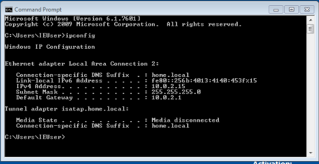
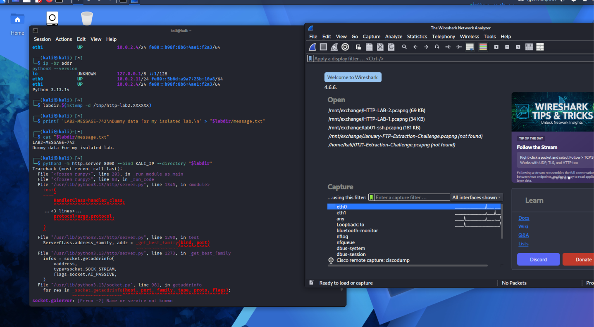
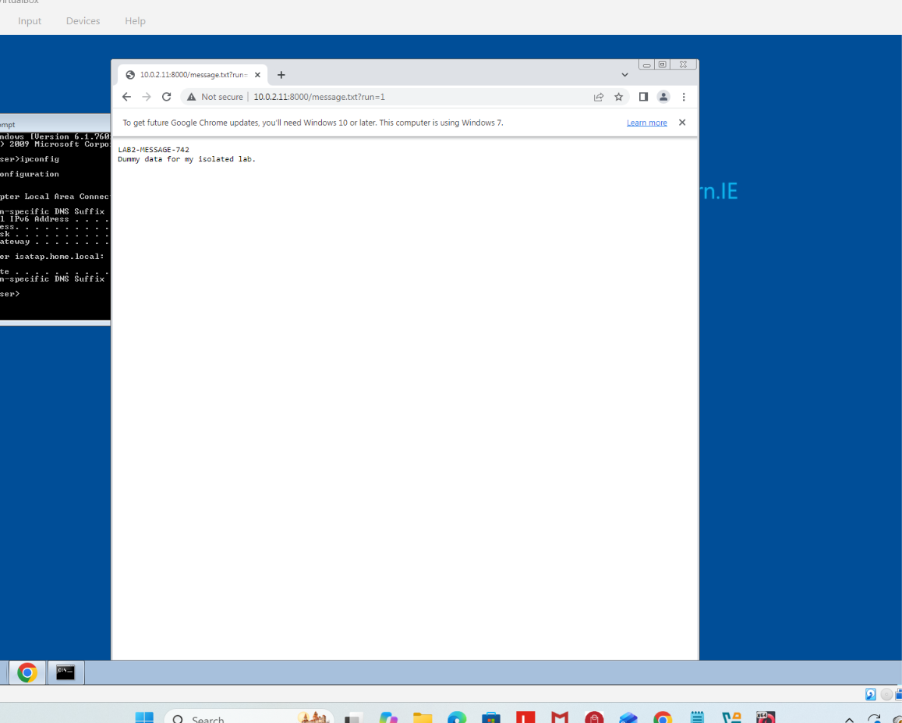
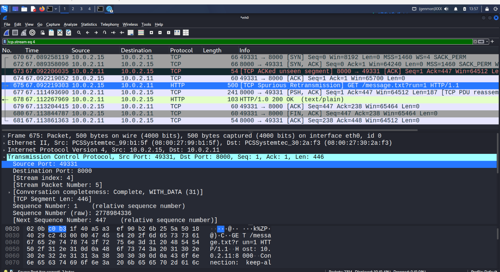
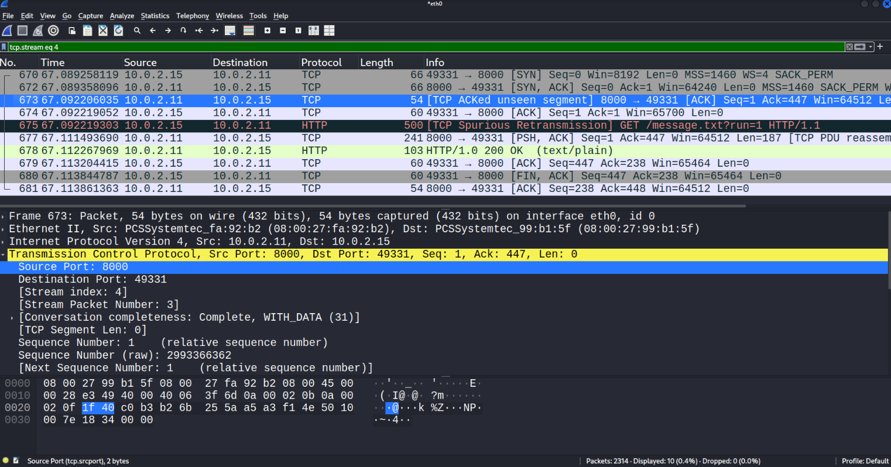
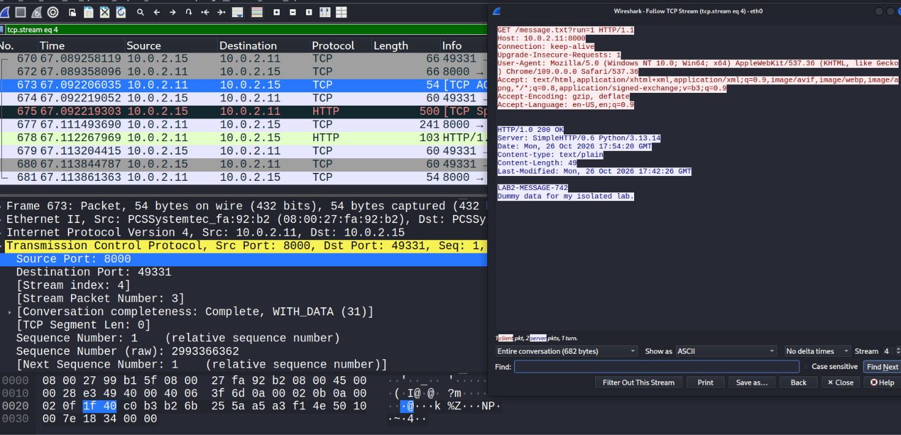
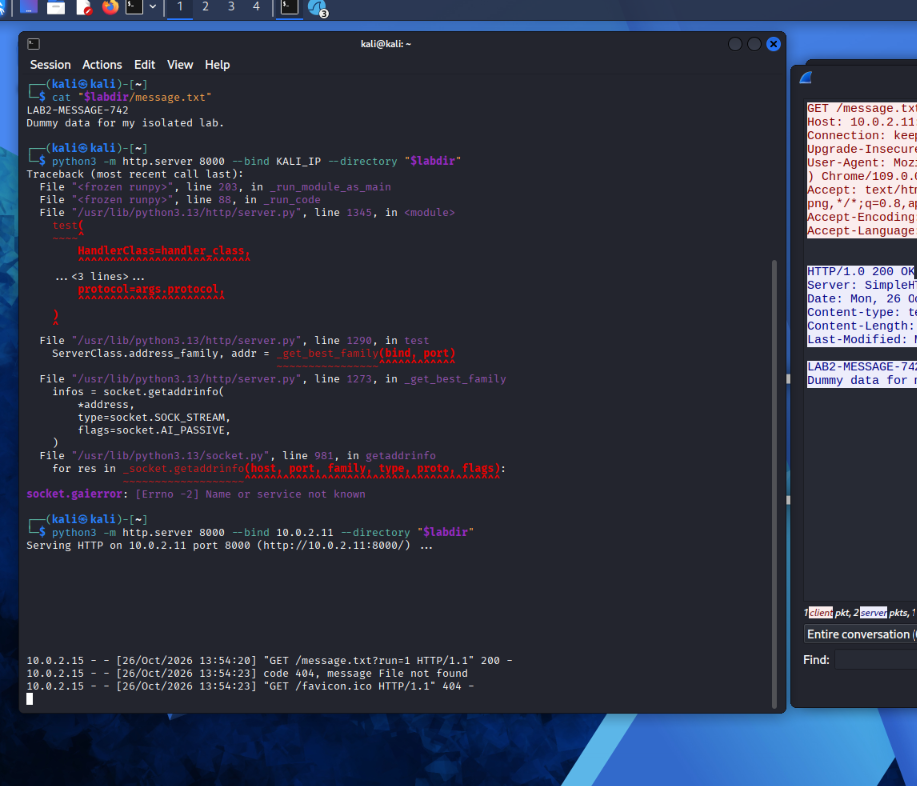

# Lab 2 — HTTP Network Traffic Investigation with Wireshark

**Status:** Screenshot-backed walkthrough published; seven evidence images included. Original packet capture and lab instructions are not attached.  
**Environment:** Authorized isolated Kali Linux and Windows virtual-machine lab, October 26, 2026.

## Objective

Set up a small HTTP server on Kali Linux, access a known test file from a Windows client, capture the exchange using Wireshark, and correlate the application-layer response with TCP packets and server-side logs.

## Lab topology (verified from screenshots)

| Component | Recorded configuration |
|---|---|
| Kali Linux HTTP server | `10.0.2.11` on `eth0` |
| Additional Kali interface | `eth1: 10.0.2.4/24` |
| Windows client | `10.0.2.15` |
| Windows default gateway | `10.0.2.1` |
| HTTP server port | TCP `8000` |
| Capturing interface | Kali `eth0` |
| Client TCP source port in captured stream | `49331` |

These are isolated lab addresses, not public internet addresses.

## Investigation walkthrough

### Step 1 — Identify the virtual-machine network addresses

On Kali, inspect the interface configuration using:

```bash
ip -br addr
```

The screenshot shows Kali `eth0` as `10.0.2.11/24`, and `eth1` as `10.0.2.4/24`.

On Windows, run:

```cmd
ipconfig
```

The Windows screenshot shows client IPv4 address `10.0.2.15`, subnet mask `255.255.255.0`, and default gateway `10.0.2.1`.

**Why it matters:** Distinguishing client, server, and gateway prevents incorrect attribution of packets.

**Evidence E02 — Windows network configuration:**



Also see [E01 — Kali network interface configuration](evidence/01-kali-network-and-test-file.png).

### Step 2 — Prepare a known test file on Kali

The terminal shows creation of a temporary lab directory, followed by creation and inspection of a file named `message.txt`.

```bash
labdir=$(mktemp -d /tmp/http-lab2.XXXXXX)
printf 'LAB2-MESSAGE-742\nDummy data for my isolated lab.\n' > "$labdir/message.txt"
cat "$labdir/message.txt"
```

The printed marker and the message body match what appears later in the browser and HTTP response. The temporary directory's random suffix is intentionally not assumed.

**Why it matters:** A unique marker makes it easier to verify the served content corresponds to this particular experiment.

**Evidence E01 — Kali configuration, test-file content, and initial terminal activity:**



### Step 3 — Start the HTTP server and troubleshoot an error

An initial server command attempted to bind to the literal placeholder `KALI_IP`, which failed:

```bash
python3 -m http.server 8000 --bind KALI_IP --directory "$labdir"
```

The terminal displayed `socket.gaierror: [Errno -2] Name or service not known`. The placeholder was not a valid resolved address.

The corrected command visible in the later screenshot is:

```bash
python3 -m http.server 8000 --bind 10.0.2.11 --directory "$labdir"
```

The server then reported it was serving HTTP on `10.0.2.11` port `8000`.

**Why it matters:** Troubleshooting was part of the exercise. A hostname or address placeholder must be replaced with the actual interface address.

**Evidence:** The initial error is visible in [E01](evidence/01-kali-network-and-test-file.png); the corrected command and successful server launch are shown in [E07](evidence/07-kali-http-server-logs.png).

### Step 4 — Request the test file from the Windows VM

The Windows Chrome screenshot shows this resource:

```text
http://10.0.2.11:8000/message.txt?run=1
```

The page rendered the marker `LAB2-MESSAGE-742` and the sentence `Dummy data for my isolated lab.`

**Why it matters:** The browser confirms the expected content was returned to the client, while the network capture and server logs provide independent evidence of the exchange.

**Evidence E03 — Browser retrieved the known test message:**



### Step 5 — Find the request and response in Wireshark

The capture was taken on Kali `eth0`. The screenshot shows the Wireshark display filter:

```text
tcp.stream eq 4
```

The conversation is between Windows client `10.0.2.15:49331` and Kali server `10.0.2.11:8000`.

Visible packets include:

| Frame | Direction | Observation |
|---|---|---|
| 670 | Client → server | TCP SYN to port 8000 |
| 672 | Server → client | TCP SYN, ACK |
| 674 | Client → server | TCP ACK |
| 675 | Client → server | HTTP GET `/message.txt?run=1` |
| 678 | Server → client | `HTTP/1.0 200 OK`, `text/plain` |
| 680–681 | Both directions | TCP connection termination packets |

**Interpretation:** The trace shows establishment of a TCP connection, an HTTP request, a successful HTTP response, and subsequent connection closure. Wireshark also flagged some packets with analysis notes such as `TCP Spurious Retransmission` and `TCP ACKed unseen segment`. These labels alone do not prove packet loss, an attack, or a service fault; the complete capture and capture conditions would be needed to investigate them further.

**Evidence E04 — Filtered Wireshark traffic:**



**Evidence E06 — Additional TCP packet analysis:**



### Step 6 — Follow the TCP stream to inspect content

In Wireshark, select a packet in the conversation and use **Follow → TCP Stream**.

The visible stream contains:

```http
GET /message.txt?run=1 HTTP/1.1
Host: 10.0.2.11:8000
```

And the server's response:

```http
HTTP/1.0 200 OK
Server: SimpleHTTP/0.6 Python/3.13.14
Content-type: text/plain
Content-Length: 49

LAB2-MESSAGE-742
Dummy data for my isolated lab.
```

**Interpretation:** The request and response are correlated within TCP stream `4`; the HTTP response is successful, and the body contains the marker created on Kali.

**Evidence E05 — Follow TCP Stream shows the request, response, and content marker:**



### Step 7 — Corroborate with the server terminal

The Kali HTTP server log screenshot shows the Windows client `10.0.2.15` requested `/message.txt?run=1` and received status `200`.

The screenshot also records an unrelated malformed request returning `404`, and `/favicon.ico` returning `404`. These 404 entries should not be confused with the successfully retrieved `message.txt`.

**Evidence E07 — Python HTTP server launch and access logs:**



## Evidence inventory — screenshots uploaded and linked

All seven PNG images are now stored in this repository's [`evidence/` folder](evidence/). They are embedded next to the relevant investigative steps above. The Windows screenshot was cropped to remove a visible practice VM password.

| ID | GitHub evidence file | What it supports |
|---|---|---|
| E01 | [Kali network and test file](evidence/01-kali-network-and-test-file.png) | Kali interfaces, test-file creation, initial server error |
| E02 | [Windows IP configuration — redacted](evidence/02-windows-ip-configuration-redacted.png) | Windows client IP, subnet and gateway |
| E03 | [Windows browser test](evidence/03-windows-browser-http-result.png) | Expected marker and message body |
| E04 | [Wireshark HTTP/TCP stream](evidence/04-wireshark-http-tcp-stream.png) | Request/response packet sequence |
| E05 | [Follow TCP Stream](evidence/05-follow-tcp-stream-http-200.png) | HTTP request, 200 OK, response content |
| E06 | [Wireshark TCP detail](evidence/06-wireshark-tcp-analysis.png) | Additional TCP packet/port evidence |
| E07 | [Kali HTTP server logs](evidence/07-kali-http-server-logs.png) | Successful server bind and HTTP access logs |

## Findings and limitations

1. Windows client `10.0.2.15` successfully retrieved the known test resource from Kali server `10.0.2.11:8000`.
2. The `200 OK` response, browser content, and Kali server access log corroborate the retrieval.
3. Wireshark provided packet-level evidence of the HTTP request/response in stream `4`.
4. The lab demonstrates protocol analysis and troubleshooting, **not** a vulnerability or security compromise.
5. The original `.pcapng` capture has not been published or independently analyzed here. Packet interpretation is based on screenshots. Original lab instructions remain outstanding.

## Skills demonstrated

- Kali Linux and Windows network configuration
- Setting up and troubleshooting a temporary Python HTTP server
- Wireshark display filters and Follow TCP Stream
- TCP handshake, ports, and connection analysis
- HTTP request/response interpretation
- Correlating browser, packet-capture, and server-log evidence
- Technical incident-style documentation
